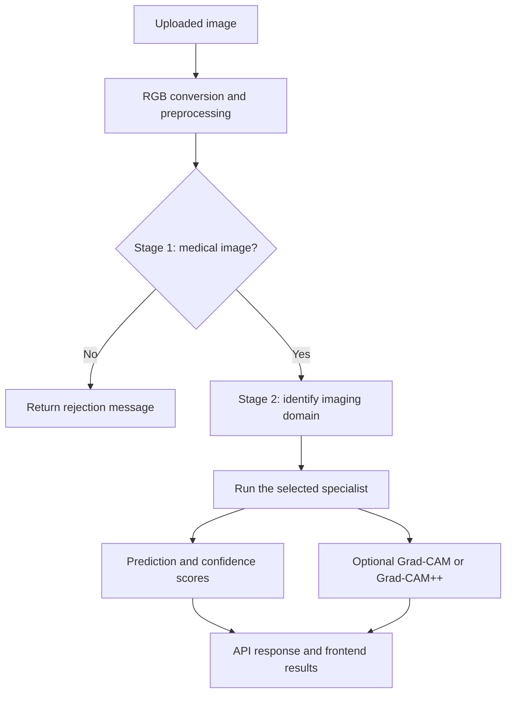

# CliniqAI

**A unified medical imaging analysis platform with automatic model routing and visual explanations.**

<kbd>PyTorch</kbd> <kbd>EfficientNet-B0</kbd> <kbd>FastAPI</kbd> <kbd>Next.js</kbd> <kbd>TypeScript</kbd> <kbd>Docker</kbd>

CliniqAI brings six medical imaging domains into one application. Users upload an image, and a two-stage router checks whether it is medical, identifies its domain, and selects the appropriate specialist model. The application returns a prediction, confidence scores, class probabilities, and an optional Grad-CAM explanation.

Developed as an academic Project Exhibition project at **VIT Bhopal**, CliniqAI focuses on practical model integration, consistent preprocessing, transparent evaluation, and deployment on limited hardware.

> **Project status:** Academic prototype. The latest documented deployment loaded all six specialists on CPU. Final router validation and deployment of the latest visualization changes remained unconfirmed as of **6 October 2026**. Clinical validation has not been established.

## Contents

- [Key Features](#key-features)
- [Supported Domains and Models](#supported-domains-and-models)
- [Architecture](#architecture)
- [Tech Stack](#tech-stack)
- [Installation and Setup](#installation-and-setup)
- [Configuration](#configuration)
- [Usage and API](#usage-and-api)
- [Project Structure](#project-structure)
- [Training and Evaluation](#training-and-evaluation)
- [Deployment](#deployment)
- [Known Limitations and Pending Work](#known-limitations-and-pending-work)
- [Development Guidelines](#development-guidelines)
- [Team](#team)

## Key Features

- **Automatic routing:** A medical-image gatekeeper and a six-domain classifier select the appropriate specialist.
- **Six specialist models:** Support for brain MRI, breast histology, kidney CT, chest X-ray, retinal imaging, and skin lesions.
- **Confidence reporting:** Predictions include confidence scores, class probabilities, and a low-confidence warning.
- **Visual explanations:** Optional Grad-CAM and Grad-CAM++ heatmaps explain the specialist’s predicted class.
- **Web interface:** A Next.js frontend provides image upload, prediction results, probability bars, and an explanation overlay.
- **Flexible checkpoint loading:** The backend reconstructs supported classifier heads from checkpoint tensor shapes and resolves stored class labels.
- **Isolated specialist failures:** Missing or incompatible specialist checkpoints can be skipped without preventing other specialists from loading.
- **CPU deployment:** A Dockerized FastAPI backend runs behind Caddy HTTPS, with frontend requests proxied through Next.js.

## Supported Domains and Models

Specialist checkpoints belong in `backend/models/specialists/`.

| Domain key | Input and prediction scope | Checkpoint |
|---|---|---|
| `brain_mri` | Brain MRI; 30 combined category-and-sequence labels | `brain_tumor_specialist_v2.pt` |
| `breast_histology` | Breast histology; `benign`, `malignant` | `breast_histology_specialist_v2.pt` |
| `kidney_ct` | Kidney CT; `Cyst`, `Normal`, `Stone`, `Tumor` | `kidney_specialist_v1.pt` |
| `pneumonia` | Chest X-ray; `NORMAL`, `PNEUMONIA` | `pneumonia_specialist_v1.pt` |
| `retinal` | Retinal images; `No DR`, `Mild`, `Moderate`, `Severe`, `Proliferative` | `retinal_specialist_v1.pt` |
| `skin_lesion` | Skin lesions; `MEL`, `NV`, `BCC`, `AK`, `BKL`, `DF`, `VASC`, `SCC` | `skin_lesion_specialist_v1.pt` |

The brain MRI model combines **10 categories with three MRI sequences: T1, T1C+, and T2**. Its categories are Astrocytoma, Ependymoma, Glioma, Hemangiopericytoma, Meningioma, Neurocytoma, Normal, Oligodendroglioma, Other, and Schwannoma. The 30 outputs therefore represent category-and-sequence combinations, rather than 30 distinct diseases.

Skin lesion codes represent melanoma, melanocytic nevus, basal cell carcinoma, actinic keratosis, benign keratosis-like lesion, dermatofibroma, vascular lesion, and squamous cell carcinoma.

Router checkpoints belong in `backend/models/router/`.

| Stage | Configured filename | Output |
|---|---|---|
| Stage 1: gatekeeper | `router_stage1_v6_efficientnet_b0.pt` | `non_medical` or `medical` |
| Stage 2: domain router | `router_stage2_v3_efficientnet_b0.pt` | One of the six domain keys above |

**Checkpoint verification is required:** The retraining notebooks used output names such as `gatekeeper_v6_no_bone.pt` and `router_stage2_v3_no_bone.pt`. Their relationship to the configured deployment filenames was not confirmed. Verify the producing run, labels, and evaluation results before copying or renaming files.

## Architecture

CliniqAI uses a **Mixture-of-Experts-style architecture with hard routing**. The routers and specialists are trained separately, and each accepted image reaches one selected specialist.



### Shared preprocessing

Every model uses the same inference input convention:

1. Decode the image and convert it to RGB.
2. Resize it to **224 × 224**.
3. Convert it to a tensor.
4. Apply ImageNet normalization:
   - Mean: `(0.485, 0.456, 0.406)`
   - Standard deviation: `(0.229, 0.224, 0.225)`

The gatekeeper continues only when its predicted label is `"medical"`. Stage 2 output labels must match the keys in `SPECIALIST_REGISTRY`.

### Explanation behavior

Grad-CAM explains the **selected specialist’s predicted class**. It does not explain the complete routing pipeline.

The implementation targets `model.features[-1]`, uses a forward hook and `torch.autograd.grad`, and serializes explanation generation with a module-level lock. An explanation failure is returned through `explanation_error` without discarding the prediction.

Heatmaps indicate regions contributing to a model output; they are not verified lesion boundaries.

## Tech Stack

Versions below reflect the documented project environment.

| Layer | Technologies |
|---|---|
| Models | PyTorch 2.5.0, Torchvision 0.20.0, ImageNet-pretrained EfficientNet-B0 |
| Backend | Python 3.11 Docker runtime, FastAPI 0.115.0, Uvicorn 0.30.6 |
| Validation and uploads | Pydantic 2.9.2, python-multipart 0.0.9 |
| Image processing | Pillow 10.4.0, NumPy |
| Frontend | Next.js 16.3.8, React 19.2.8, TypeScript, Tailwind CSS 4 |
| Training | Jupyter notebooks and Python helper scripts |
| Hosting | Vercel frontend; Docker backend on AWS EC2; Caddy HTTPS |

## Installation and Setup

### 1. Obtain the source and model weights

The repository was private at the latest documented handoff. Repository access and the required checkpoints must be obtained from the maintainers.

```bash
git clone https://github.com/anish27863/CliniqAI.git
cd CliniqAI
```

Confirm that your checkout contains the backend, frontend, and intended Grad-CAM changes. Their final merge status was still pending in the latest handoff.

Required tools:

- Git
- Docker for the documented backend setup
- Node.js and npm for the frontend

No public model-download URL or automated checkpoint-download step has been documented.

### 2. Install the checkpoints

Place the **two router files** and **six specialist files** in:

```text
backend/models/router/
backend/models/specialists/
```

Check their filenames against `backend/app/config.py`.

Training outputs also exist under the root `models/` directory. The root and backend copies are maintained separately; there is no documented automatic synchronization step.

### 3. Build and start the backend

The documented deployment uses CPU-only PyTorch. Ensure `backend/Dockerfile` contains the CPU configuration below before building. An older local Dockerfile used port `7860` and could pull large CUDA dependencies.

```dockerfile
FROM python:3.11-slim

WORKDIR /code

RUN pip install --no-cache-dir "numpy<2" torch==2.5.0 torchvision==0.20.0 --index-url https://download.pytorch.org/whl/cpu

COPY requirements.txt .
RUN grep -v -E '^(torch|torchvision)' requirements.txt > req-docker.txt && pip install --no-cache-dir -r req-docker.txt

COPY app/ ./app/
COPY models/ ./models/

EXPOSE 8000

CMD ["uvicorn", "app.main:app", "--host", "0.0.0.0", "--port", "8000"]
```

From the repository root:

```bash
cd backend
docker build -t cliniqai .
docker run -d --name cliniqai --restart unless-stopped --memory 1400m -p 8000:8000 cliniqai
```

After startup, open:

- [Health endpoint](http://localhost:8000/health)
- [Interactive API documentation](http://localhost:8000/docs)

Confirm that the health response lists all six specialists. Successful loading establishes availability, not prediction accuracy.

### 4. Start the frontend

In a separate terminal, from the repository root:

```bash
cd frontend
npm install
npm run dev
```

Open the development URL printed by Next.js.

The frontend calls `/api/health` and `/api/analyze`. Its rewrite configuration defaults to `http://localhost:8000`, so the local backend works without setting a custom proxy target.

## Configuration

### Frontend environment variable

| Variable | Purpose | Default |
|---|---|---|
| `API_PROXY_TARGET` | Backend origin used by the Next.js `/api/:path*` rewrite | `http://localhost:8000` |

For deployment, set `API_PROXY_TARGET` to the backend’s HTTPS origin, **without a trailing slash**.

This value is read in `frontend/next.config.ts` at build time. Changing it requires rebuilding or redeploying the frontend. On Vercel, configure it for the relevant Production and Preview environments.

### Backend Python settings

These settings are defined in `backend/app/config.py`; they are not documented as environment-variable overrides.

| Setting | Purpose or documented value |
|---|---|
| `MODELS_ROOT` | Backend model directory: `backend/models` |
| `ROUTER_STAGE1_PATH` | Gatekeeper checkpoint path |
| `ROUTER_STAGE2_PATH` | Six-domain router checkpoint path |
| `SPECIALISTS_DIR` | Specialist checkpoint directory |
| `SPECIALIST_REGISTRY` | Maps domain keys to specialist filenames |
| `CONFIDENCE_THRESHOLD` | `0.90` |
| `IMG_SIZE` | `224` |
| `IMAGENET_MEAN` / `IMAGENET_STD` | Shared normalization values listed above |

Preserve the label order stored in each checkpoint. The loader checks `class_names`, then `classes`, and then known fallback labels. Placeholder labels such as `class_0` indicate that the label mapping still needs attention.

## Usage and API

### Web application

1. Open the frontend.
2. Upload an image from a supported domain.
3. Review the detected domain, prediction, confidence, and class probabilities.
4. Inspect the Grad-CAM overlay when available.
5. Check low-confidence warnings or rejection messages before interpreting the result.

### Endpoints

| Method | Endpoint | Purpose |
|---|---|---|
| `GET` | `/health` | Inspect model availability and runtime device |
| `POST` | `/analyze` | Analyze a multipart image upload |
| `GET` | `/docs` | Open FastAPI’s interactive API documentation |

The upload field is named `file`.

Replace `YOUR_IMAGE_PATH` with the path to an image:

```bash
curl -X POST "http://localhost:8000/analyze" \
  -F "file=@YOUR_IMAGE_PATH"
```

Request a Grad-CAM explanation:

```bash
curl -X POST "http://localhost:8000/analyze?explain=true&method=gradcam" \
  -F "file=@YOUR_IMAGE_PATH"
```

For Grad-CAM++, use `method=gradcampp`. This spelling avoids URL handling of `+` characters.

**Windows PowerShell:** Use Swagger UI or `curl.exe` explicitly:

```powershell
curl.exe -X POST "http://localhost:8000/analyze?explain=true&method=gradcampp" -F "file=@YOUR_IMAGE_PATH"
```

### Response fields

The response schema includes:

| Fields | Meaning |
|---|---|
| `is_medical`, `gatekeeper_confidence` | Gatekeeper decision and confidence |
| `modality`, `modality_confidence` | Selected domain and routing confidence |
| `prediction`, `prediction_confidence` | Specialist output and confidence |
| `all_class_probabilities` | Returned specialist class probabilities |
| `low_confidence_warning`, `message` | Warning and explanatory information |
| `explanation`, `explanation_error` | Optional explanation result or failure information |

Explanation data includes the selected class, confidence, method, a `degenerate` flag, and base64-encoded images in `original_png_b64`, `overlay_png_b64`, and `heatmap_png_b64`.

A source change limits `all_class_probabilities` to the four highest scores. Its deployment was unconfirmed, so clients should accept a variable number of returned classes.

## Project Structure

| Path | Responsibility |
|---|---|
| `backend/app/main.py` | FastAPI application and endpoints |
| `backend/app/config.py` | Model paths, registry, thresholds, and preprocessing settings |
| `backend/app/schemas.py` | Prediction and explanation response schemas |
| `backend/app/gradcam.py` | Grad-CAM and Grad-CAM++ implementation |
| `backend/app/inference/model_loader.py` | Checkpoint loading, head reconstruction, and label resolution |
| `backend/app/inference/pipeline.py` | Model registry and inference orchestration |
| `backend/app/inference/preprocess.py` | Shared image transform |
| `backend/models/` | Checkpoints used by the backend |
| `backend/requirements.txt` | Backend dependencies |
| `backend/Dockerfile` | Backend container definition |
| `frontend/src/app/page.tsx` | Upload interface, predictions, probability bars, and overlay |
| `frontend/next.config.ts` | Backend API proxy rewrite |
| `models/` | Training checkpoints and exported models |
| `data/raw/` | Training datasets and manual evaluation images |
| `notebooks/` | Training and evaluation notebooks |
| `scripts/` | Dataset utilities, shared training code, and diagnostic tools |

## Training and Evaluation

### Training workflow

The six-domain router workflow uses:

- `notebooks/gatekeeper_v6_no_bone.ipynb`
- `notebooks/router_stage2_v3_no_bone.ipynb`
- `scripts/router_common.py`

Common training settings include EfficientNet-B0 transfer learning, 224 × 224 inputs, batch sizes of 32–64, learning rate `1e-3`, weight decay `1e-4`, `ReduceLROnPlateau`, and early stopping.

The router utility supports grouped splits, overlap checks, resumable checkpoints, per-class and per-source reports, and explicit PASS/FAIL checks against expected labels. The final router recipe uses **unweighted cross-entropy** following a regression associated with changing class weights.

Checkpoint exports include `model_state_dict`, class labels, output count, and architecture metadata, with a companion `.history.json` where produced by the training utility.

### Data and split conventions

- **Breast histology:** BreakHis, 7,909 images; patient-grouped and subtype-stratified splitting.
- **Brain MRI specialist:** 11,300 images across 30 category-and-sequence folders.
- **Router positives:** 47,522 images across the six supported domains after configured caps.
- **Gatekeeper negatives:** 191,020 images from food, faces, natural images, scenes, ImageNet samples, and synthetic screenshots.
- **Held-out generalization:** The 335,456-image fruits source is excluded from training.
- **Router splits:** Grouped 80/10/10 splitting with seed `42`, using available patient, case, or source identifiers.

Legacy CIFAR-10 negatives and the old IDC breast-histology folder are excluded from the final router data configuration.

### Reported results

| Evaluation | Recorded result | Interpretation |
|---|---|---|
| Breast histology overall | **91.6%** on 943 test images | Primary reported specialist test result |
| Breast histology excluding papillary carcinoma | **94.9%** | Conditional subset result, not overall accuracy |
| Papillary carcinoma subgroup | **47.7%** | Six source patients and one test patient limit interpretation |
| Kidney CT external example | A real stone image predicted as `Normal` at **97%** confidence | Unresolved failure; label-order investigation did not establish a mapping error |
| Final six-domain routers | Final external validation not confirmed | Earlier router scores do not establish the quality of the configured checkpoints |

A final end-to-end accuracy result and measured production latency benchmark have not been established.

### Before accepting a new checkpoint

1. Verify labels, output dimensions, preprocessing, and the producing training run.
2. Reload the exported checkpoint through the backend loader.
3. Inspect per-class and per-source results.
4. Test independent real medical and non-medical images.
5. Confirm that the intended files are copied into `backend/models/`.
6. Verify health and image analysis through the frontend.

Manual evaluation folders include `data/raw/manual_sanity_check/`, `data/raw/manual_sanity_check_negative/`, and `data/raw/manual_sanity_check_stage2/<modality>/`. Empty folders do not provide validation evidence.

## Deployment

The documented deployment consists of:

- **Vercel:** Hosts the Next.js frontend and proxies `/api/*` requests.
- **AWS EC2:** Runs the Dockerized FastAPI backend on an Ubuntu `t3.small` instance.
- **Caddy:** Provides HTTPS and forwards requests to backend port `8000`.

The recorded server used approximately 1.9 GiB RAM, 2 GB swap, and a 1,400 MB backend container memory limit. CPU-only PyTorch is required for this deployment configuration.

Operational considerations:

- Keep the local and server Dockerfiles aligned.
- Upload model weights separately from routine source updates.
- Keep backend port `8000` closed in the EC2 security group; expose HTTP/HTTPS through Caddy.
- Update Caddy and `API_PROXY_TARGET` if the backend address changes.
- Redeploy the frontend after changing its proxy target.
- Verify a successful rebuild before assuming new source changes are live.

The last recorded rebuild failed because CUDA dependency layers exhausted disk space. The previously built container remained active, leaving the brighter heatmap rendering and top-four probability change unverified in production.

## Known Limitations and Pending Work

- Medical images outside the six supported domains have no dedicated unsupported-domain route.
- Bone-fracture support was removed from the active scope.
- Final router checkpoint identity, training completion, and real-image validation need confirmation.
- Historical kidney CT/brain MRI and breast histology/skin lesion routing confusions require external checks.
- Kidney CT performance on independent images remains an open issue.
- Grad-CAM checks remain pending for brain MRI, skin lesions, and pneumonia, particularly for attention to borders or image markers.
- An opacity slider and user-selected explanation class are proposed improvements.
- Production inference is synchronous on CPU; explanation requests are serialized.
- Authentication and persistent user-history storage are not documented as implemented.
- The recorded backend CORS configuration allows all origins and needs review for the intended deployment.

## Development Guidelines

Use feature branches and pull requests into `develop`, followed by integration into `main`.

Keep private keys, credentials, backup files, deployment archives, generated explanation images, `node_modules`, and `.next` out of version control.

For model and dataset work:

- Keep Windows multiprocessing dataset classes in importable Python modules.
- Use the documented `num_workers=4` starting point; excessive workers previously caused memory problems.
- Deduplicate image paths on case-insensitive filesystems.
- Convert uploaded images to RGB before preprocessing.
- Inspect patient/source counts behind subgroup metrics.
- Record split changes and class balance whenever a data source changes.
- Retain the documented `kaggle==1.6.17` pin for the training workflow; newer versions caused large-download memory failures in the recorded environment.

Confirm licensing and redistribution permissions separately for source code, model weights, and third-party datasets.

## Team

Developed at **VIT Bhopal** by:

- **Anish Saha**
- **Roneet Sarode**
- **Khushboo Patil**
